# WorldSim

> **Physics-world simulation infrastructure.**  
> A deterministic, multi-scale physics kernel that any project can consume as a service — with live **WebGL2 3D** visualization and a Python SDK.

[](https://github.com/hyqzz/worldsim/actions/workflows/ci.yml)
[](LICENSE)
[](CHANGELOG.md)
[](https://www.rust-lang.org)
[](#supply-chain)

**English** · [中文 README](README.zh-CN.md) · [Architecture](docs/DESIGN.md) · [API](docs/api.md) · [Viewer](docs/viewer.md) · [Training](docs/training.md) · [Changelog](CHANGELOG.md)

```
 ███╗   ███╗ ██████╗ ██████╗ ██╗     ██████╗ ███████╗██╗███╗   ███╗
 ████╗ ████║██╔═══██╗██╔══██╗██║     ██╔══██╗██╔════╝██║████╗ ████║
 ██╔████╔██║██║   ██║██████╔╝██║     ██║  ██║███████╗██║██╔████╔██║
 ██║╚██╔╝██║██║   ██║██╔══██╗██║     ██║  ██║╚════██║██║██║╚██╔╝██║
 ██║ ╚═╝ ██║╚██████╔╝██║  ██║███████╗██████╔╝███████║██║██║ ╚═╝ ██║
 ╚═╝     ╚═╝ ╚═════╝ ╚═╝  ╚═╝╚══════╝╚═════╝ ╚══════╝╚═╝╚═╝     ╚═╝
       Constants → Laws → Particles × Fields × Links → Streams
```


### Table of Contents

- [Why WorldSim?](#why-worldsim)
- [60-second Quickstart](#60-second-quickstart)
- [What It Simulates](#what-it-simulates)
- [Architecture & Supply Chain](#architecture--supply-chain)
- [Configuration](#configuration)
- [API Surface](#api-surface)
- [Python SDK](#python-sdk)
- [Training (Gymnasium + Batch)](#training-gymnasium--batch)
- [3D Viewer](#3d-viewer)
- [Demos — See It Work](#demos--see-it-work)
- [Project Layout](#project-layout)
- [Roadmap](#roadmap)
- [Contributing](#contributing)

---

### Why WorldSim?

Most physics engines are *libraries you link*. WorldSim is **infrastructure you run** — like a database for physics:

- **Any project** (game, robotics/digital twin, research, teaching) talks to the same HTTP/WebSocket API. No engine lock-in.
- **Precision is a service** — `quality: low|medium|high` plus a `budget_ms` QoS controller downgrades gracefully under load and upgrades when spare. The same scene runs at 4k or 48k particles depending on budget.
- **Correctness is tested, not claimed** — every commit runs 7 analytic validation problems (projectile, Kepler orbit, heat diffusion, fluid settlement, determinism, snapshot, fork) plus API contract tests (59 total).
- **Deterministic & time-travelable** — seeded RNG + event log → snapshots, restore, fork parallel universes, and cross-run reproducibility.

---

## 60-second Quickstart

### 1 · Run the server

```bash
git clone https://github.com/hyqzz/worldsim && cd worldsim
cargo run -p worldsim -- demo --port 8090
# Viewer  http://127.0.0.1:8090/viewer/   (WebGL2 3D)
# Health  http://127.0.0.1:8090/healthz
# API     http://127.0.0.1:8090/v1/worlds
```

Or download the prebuilt binary from [Releases](https://github.com/hyqzz/worldsim/releases).

### 2 · Open the 3D viewer

Visit `http://127.0.0.1:8090/viewer/` — the demo world is already running: a water tank with a floating wood ball, a sinking steel ball, and a heat source.

| Control | Action |
|---|---|
| Drag | Orbit camera (yaw/pitch) |
| Scroll | Zoom |
| Click ground | Spawn a sphere at the 3D ray intersection |
| Pause/Resume, Speed, Quality | Control time scale and precision |

> The viewer is a **true WebGL2 3D perspective renderer** (VP matrix + depth test + point sprites). See [docs/viewer.md](docs/viewer.md). Offline 3D is also available via `demos/three_d_scene.py` (Matplotlib Axes3D).

### 3 · Talk to the API (curl)

```bash
# create a manual world for deterministic control
curl -s -X POST http://127.0.0.1:8090/v1/worlds \
  -H 'Content-Type: application/json' \
  -d '{"name":"hello","config":{"auto_start":false,"quality":"low"}}' | jq
# → {"id":"...","world":{...}}
WID=<id>

# step + inject atomically (one request = action → simulation → observation)
curl -s -X POST http://127.0.0.1:8090/v1/worlds/$WID/step \
  -H 'Content-Type: application/json' \
  -d '{"ticks":1,"events":[
    {"type":"spawn_fluid","center":[0,1.0,0],"radius":0.7},
    {"type":"spawn_sphere","material":"wood","pos":[0.4,2.6,0],"radius":0.17}
  ]}' | jq .observation.bodies.n

# probe anywhere in space (temperature / density / pressure / velocity)
curl -s "http://127.0.0.1:8090/v1/worlds/$WID/probe?x=0&y=0.5&z=0&quantity=temperature" | jq

# columnar state for scientific clients
curl -s "http://127.0.0.1:8090/v1/worlds/$WID/state/full?include_fluid=true" | jq .bodies.px
```

### 4 · Python SDK (stdlib only for the base client)

```bash
pip install -e sdk/python
# for training: pip install -e "sdk/python[training]"
python sdk/python/examples/quickstart.py
```

```python
from worldsim import Client
c = Client("http://127.0.0.1:8090")
w = c.create_world(name="hello", config={"auto_start": False, "quality": "low"})
wid = w["id"]
# atomic step + observation
r = c.step_sync(wid, ticks=1, events=[
    {"type": "spawn_fluid", "center": [0, 1.0, 0], "radius": 0.7},
])
print(r["observation"]["bodies"]["n"])  # Base64 f64 columns, decoded via c.decode_f64_array()
```

---

## What It Simulates

| Scale | Theory | Solver | Validation |
|---|---|---|---|
| **Rigid** | Impulse + Coulomb friction + Baumgarte | Symplectic Euler, BVH grid, sleep/wake | Projectile vs analytic **< 0.8%** |
| **Fluid** | WCSPH (cubic spline 2h, Tait γ=7, Monaghan α, 27-cell grid) | CFL-limited substeps, Tait B=c²ρ₀/7 | Tank settles, mass conserved **< 1e-9** |
| **Thermal** | ∂T/∂t = α∇²T + advection + sources | Explicit 7-pt + semi-Lagrangian (grid-sampled) | 1-D cosine decay **< 5%** |
| **Planetary** | Softened Newtonian G·m₁m₂/r² | Leapfrog KDK | 2-body 5 periods, energy drift **< 5e-4** |
| **Coupling** | Archimedes + ½CdρAv² + 6πμrv | Sampled at bodies (27-cell) | Wood floats / steel sinks |

All solvers share **SoA buffers, integer ticks, and zone-indexed neighbor search**. The default heat grid is `16³` (48³ for high-quality offline), fluid `h=0.06`, QoS caps keep ticks < 16 ms.

---

## Architecture & Supply Chain

```
Viewer (WebGL2 3D, persistent buffers) ─┐
Python SDK (stdlib) / Gym / Batch       ─┤
curl / any HTTP client                   ─┤
              → HTTP/WS/SSE + Batch/WDL (ws-server, 0 deps)
                    ↓
              World registry + Scheduler (~60Hz, rate-controlled, QoS)
                    ↓
              World { tick, time, RNG stream, inbox, replay log }
               ├─ Rigid (impulse/BVH)
               ├─ Fluid (WCSPH 27-cell)
               ├─ Heat (explicit + semi-Lagrangian, macro-tick TTL)
               └─ N-body (KDK, recomputed on restore)
                    ↓
              Coupling (buoyancy + drag) + Snapshot/Hash/Fork
```

```
ws-core      (constants, math, RNG, JSON, Base64, SHA-1)   0 deps
ws-domain    (config, materials, events, WDL)              → ws-core
ws-solvers   (rigid, fluid, heat, nbody, spatial, law)     → ws-core
ws-engine    (world, QoS, snapshot, batch)                 → core+domain+solvers
ws-server    (HTTP/WS, API, viewer embed)                  → engine
worldsim     (binary demo|serve)                           → server
```

> **Zero runtime dependencies** outside `std`. Auditable, reproducible, single static binary.

---

## Configuration

Use `seed_hex` for 64-bit seeds (JSON numbers lose bits above 2⁵³) and `auto_start:false` for synchronous training:

```json
{
  "seed_hex": "ffffffffffffffff",
  "auto_start": false,
  "dt": 0.0166667,
  "bounds": {"min": [-2, 0, -2], "max": [2, 4, 2]},
  "container": true,
  "gravity": [0, -9.80665, 0],
  "quality": "low",
  "systems": {
    "rigid":  {"restitution": 0.6, "friction": 0.35, "substeps": 2},
    "fluid":  {"enabled": true, "h": 0.06, "rho0": 1000, "c": 12, "visc_alpha": 0.08},
    "heat":   {"enabled": true, "res": [16,16,16], "alpha": 1.43e-7, "volumetric_capacity": 4.186e6},
    "nbody":  {"enabled": false, "softening": 0.01}
  }
}
```

### Precision as a service

```bash
# Lock quality or let it auto-adapt
curl -X PUT http://127.0.0.1:8090/v1/worlds/$WID/precision \
  -H 'Content-Type: application/json' -d '{"quality":"high","budget_ms":8}'

# Batch transition: per-env different actions in one request
curl -s -X POST http://127.0.0.1:8090/v1/batch/transition \
  -H 'Content-Type: application/json' \
  -d '{"transitions":[{"id":"train-0000","events":[{"type":"apply_force","target":{"body":0},"force":[1,0,0]}]},{"id":"train-0001","events":[]}],"ticks_per_world":1}' | jq
```

See [docs/configuration.md](docs/configuration.md) and [docs/api.md](docs/api.md).

---

## API Surface

```
Worlds     POST /v1/worlds  GET /v1/worlds  GET /v1/worlds/:id  DELETE
Control    POST /v1/worlds/:id/control   {pause|resume|step|flush|set_rate}
           POST /v1/worlds/:id/step      {ticks, events, include_fluid, include_fields}
           POST /v1/worlds/:id/observe   {probes, include_fluid, include_fields}
           GET  /v1/worlds/:id/state/full ?include_fluid&include_fields&fluid_stride
Precision  PUT  /v1/worlds/:id/precision {quality:auto|low|med|high, budget_ms}
Events     POST /v1/worlds/:id/events   {spawn_sphere|capsule|nbody|fluid|heat_source|apply_force|set_gravity|remove_body}
Probes     GET  /v1/worlds/:id/probe?x&y&z&q=temperature|density|pressure|velocity
State      GET  /v1/worlds/:id/state
Streams    GET  /v1/worlds/:id/stream    → WebSocket (bodies+fluid+nbody 3×3D) or ?format=sse
Snapshots  POST /v1/worlds/:id/snapshots  GET …/snapshots/:sid  POST …/restore  POST …/fork
Batch      POST /v1/batch/create  POST /v1/batch/step  POST /v1/batch/transition  POST /v1/batch/inject
WDL        POST /v1/wdl/parse  POST /v1/worlds/from-wdl
```

All JSON over UTF-8. Snapshots/observations use Base64 `f64` LE columns; decode in Python via `Client.decode_f64_array()`.

---

## Python SDK

```bash
pip install -e sdk/python           # base (stdlib only)
pip install -e "sdk/python[training]" # + numpy, gymnasium
```

```python
from worldsim import Client
c = Client("http://127.0.0.1:8090")

# Manual world: tick only when you call step
w = c.create_world(config={"auto_start": False, "seed_hex": "000000000000002a"})
wid = w["id"]

# Atomic inject + step → observation
r = c.step_sync(wid, ticks=1, events=[
    {"type": "spawn_sphere", "material": "steel", "pos": [0, 2, 0], "radius": 0.12}
])
obs = r["observation"]
px = c.decode_f64_array(obs["bodies"]["px"])  # np.ndarray of x positions
print(r["state"]["tick"], px)

# Probes + full columnar state
print(c.probe(wid, 0, 0.5, 0, quantity="temperature"))
print(c.state_full(wid, include_fluid=True)["bodies"]["n"])
print(c.observe(wid, probes=[{"pos": [0,0.5,0], "quantity": "density"}]))

# WDL + snapshots
print(c.parse_wdl('{"world":{"seed":7},"entities":[{"ball":{"material":"wood","at":[0,2,0]}}]}'))
snap = c.snapshot_create(wid)
c.restore(wid, snapshot_id=snap["snapshot_id"])
fork = c.fork(wid, name="parallel")
```

---

## Training (Gymnasium + Batch)

```python
# Single env — synchronous, no scheduler race
import gymnasium as gym
from worldsim.gym import WorldSimEnv
env = WorldSimEnv("http://127.0.0.1:8090",
                  config={"quality":"low","systems":{"fluid":{"enabled":False}}},
                  body_slots=1, max_steps=200,
                  reward_fn=lambda obs, act: -float((act**2).sum()))
obs, info = env.reset(seed=123)
for _ in range(200):
    obs, reward, terminated, truncated, info = env.step(env.action_space.sample())

# Vectorized — 32 envs, per-env different forces
from worldsim.training import BatchTrainer
t = BatchTrainer("http://127.0.0.1:8090")
ids = t.create(32, config={"quality":"low","dt":0.0166677})
# one-request transition
results = t.transition([
    {"id": ids[0], "events": [{"type":"apply_force","target":{"body":0},"force":[1,0,0]}]},
    {"id": ids[1], "events": []},
], ticks_per_world=1)
print(results[0]["hash"], results[0]["tick"])
```

See [docs/training.md](docs/training.md).

---

## 3D Viewer

- **Online**: `cargo run -p worldsim -- demo --port 8090` → http://127.0.0.1:8090/viewer/
- **Offline**: `python demos/three_d_scene.py --port 8090` → `demos/output/three_d_scene.gif` (Matplotlib Axes3D over the same public state columns)

The WebSocket stream is a true 3D data plane (`bodies px/py/pz + fluid px/py/pz + nbody px/py/pz`), rendered with a perspective VP matrix, depth test, and point sprites. See [docs/viewer.md](docs/viewer.md).

---

## Demos — See It Work

> All demos are standalone scripts. They start a server if needed, step real physics, and write `./demos/output/` PNG/GIFs.
>
> ```bash
> pip install -e sdk/python           # + pip install -r demos/requirements.txt for GIFs
> cargo build -p worldsim --release
> python demos/run_all.py             # all 11 demos
> python demos/buoyancy_demo.py       # single demo
> python -m demos.buoyancy_demo --port 8090
> ```

### 1 · Rigid Bodies — free fall, bounce, Coulomb friction

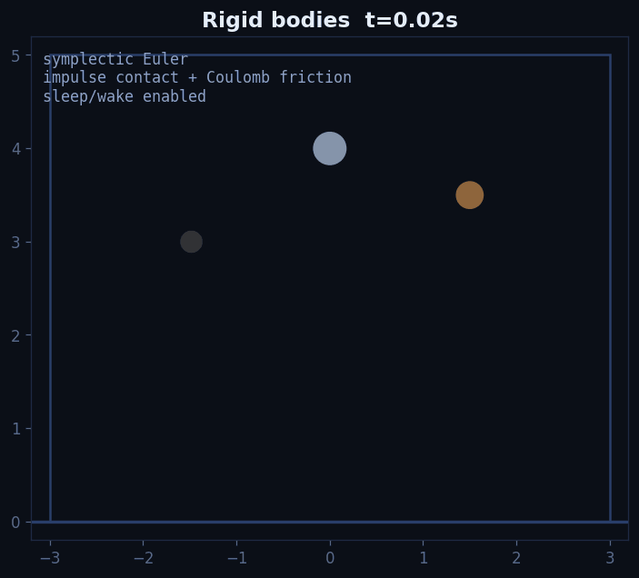

**What it shows:** Symplectic Euler integration, impulse contact + Baumgarte correction, Coulomb friction, sleep/wake. Three materials (steel/wood/rubber) fall from different heights under `g=9.81`.

**Code:**
```python
c = Client("http://127.0.0.1:8090")
w = c.create_world(config={"auto_start":False,"quality":"high",
  "bounds":{"min":[-3,0,-1],"max":[3,5,1]},
  "systems":{"fluid":{"enabled":False},"heat":{"enabled":False}}})
c.inject(w["id"], [
  {"type":"spawn_sphere","material":"steel","pos":[0,4,0],"radius":0.18},
  {"type":"spawn_sphere","material":"wood","pos":[1.5,3.5,0],"radius":0.15},
])
for _ in range(180):
    obs = c.step_sync(w["id"], 1)["observation"]
    px = c.decode_f64_array(obs["bodies"]["px"])
```

**Run:** `python demos/rigid_bodies.py` → `demos/output/rigid_bodies.gif` (60 frames)

---

### 2 · WCSPH Dam Break — 2,109 particles as they actually fall

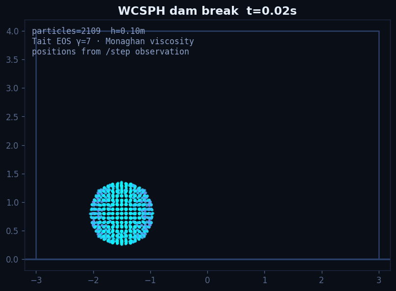

**What it shows:** WCSPH with cubic spline 2h, Tait γ=7, Monaghan viscosity. The GIF is drawn from the **real `px/py` columns** returned by `/step`, not a schematic.

**Code:**
```python
w = c.create_world(config={"auto_start":False,"quality":"low",
  "systems":{"fluid":{"enabled":True,"h":0.10}}})
c.inject(w["id"], [{"type":"spawn_fluid","center":[-1.5,0.8,0],"radius":0.62}])
obs = c.step_sync(w["id"], 1, include_fluid=True)["observation"]
px = c.decode_f64_array(obs["fluid"]["px"])
```

**Run:** `python demos/fluid_dam_break.py` → `demos/output/dam_break.gif`

---

### 3 · Buoyancy — density decides fate

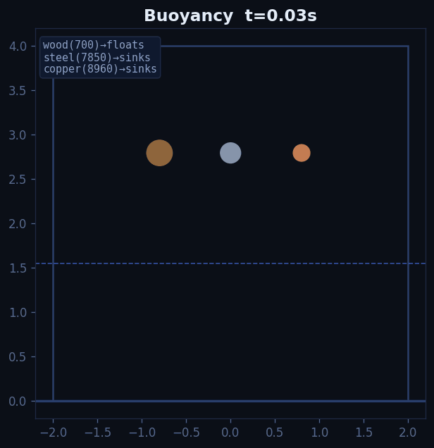

**What it shows:** Coupling via `ρ_sample` at each body: `Fb=-g·ρ·V` plus drag. Wood (700) floats, steel (7850) and copper (8960) sink. Positions are decoded from the server and plotted each frame.

**Run:** `python demos/buoyancy_demo.py` → `demos/output/buoyancy.gif`

---

### 4 · Heat Diffusion — centre z-slice of the true 3D field

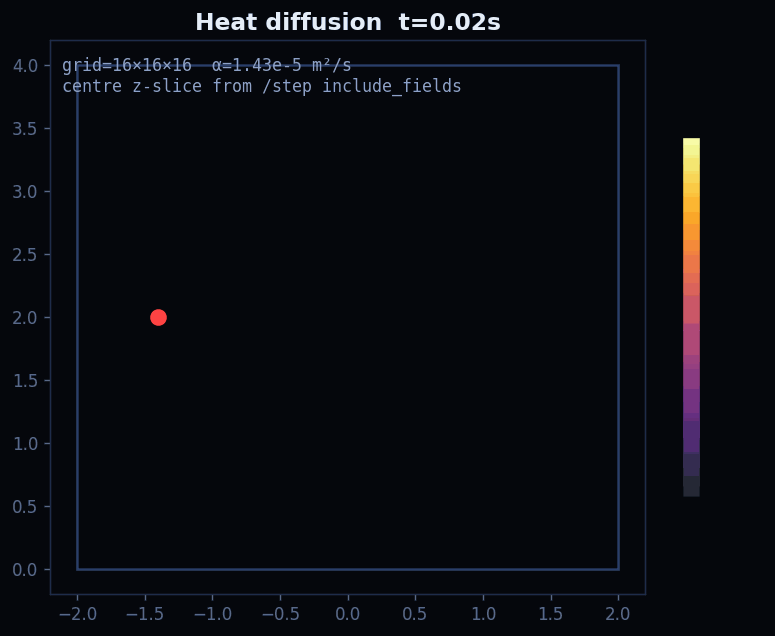

**What it shows:** 3D heat grid `16³`, `α=1.43e-5` with a 5kW source. Visualized via `include_fields=true` → Base64 `temperature` column → `reshape(nz,ny,nx)[nz//2]` centre slice. Validation: cosine mode decays as `exp(-απ²t/L²)` within 5%.

**Code:**
```python
obs = c.step_sync(wid, 1, include_fields=True)["observation"]
fields = obs["fields"]
vals = c.decode_f64_array(fields["temperature"]).reshape(8,16,16)[8]  # 16³ example
```

**Run:** `python demos/heat_diffusion.py` → `demos/output/heat_diffusion.gif` (40 frames)

---

### 5 · N-body Orbits — two 10¹⁰ kg masses, leapfrog KDK

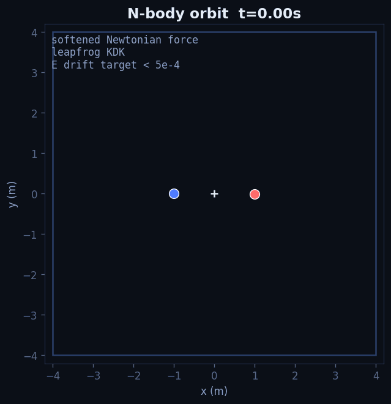

**What it shows:** Softened Newtonian force, leapfrog KDK. The demo now uses the **public `spawn_nbody` event** and plots `observation.nbody px/py` — no longer a stale schematic.

**Code:**
```python
w = c.create_world(config={"auto_start":False,"gravity":[0,0,0],
  "systems":{"nbody":{"enabled":True},"fluid":{"enabled":False}}})
c.inject(w["id"], [
  {"type":"spawn_nbody","mass":1e10,"pos":[-1,0,0],"vel":[0,0.408,0]},
  {"type":"spawn_nbody","mass":1e10,"pos":[1,0,0],"vel":[0,-0.408,0]},
])
obs = c.step_sync(w["id"], 1)["observation"]
px = c.decode_f64_array(obs["nbody"]["px"])
```

**Run:** `python demos/nbody_orbits.py` → `demos/output/orbits.gif` (180 frames, `G·m₁m₂/r²` label on plot)

---

### 6 · Snapshot / Fork — parallel universes

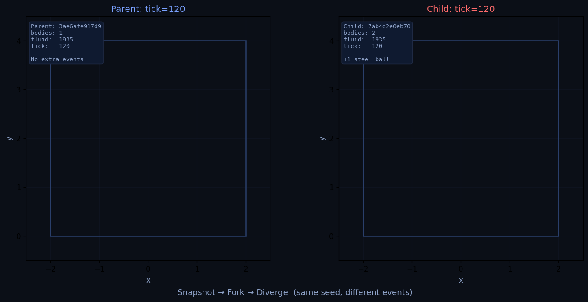

**What it shows:** `tick 60 → snapshot snap_000001 → fork → child gets steel ball → 60 ticks → parent hash ≠ child hash`. Proves time-travel and deterministic divergence.

**Code:**
```python
snap = c.snapshot_create(wid)["snapshot_id"]   # Base64 f64 LE + seed_hex + heat_sources + active_forces + replay_log
child = c.fork(wid, name="parallel")["id"]
c.inject(child, [{"type":"spawn_sphere","material":"steel","pos":[0.5,3,0],"radius":0.1}])
```

**Run:** `python demos/snapshot_fork.py` → `demos/output/snapshot_fork.png`

---

### 7 · Batch Training — 32 envs × 20 ticks

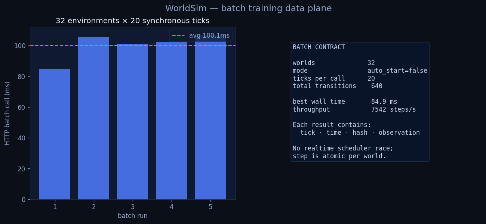

**What it shows:** `POST /v1/batch/{create,transition}` with a fixed worker pool (not one thread per world). The demo's titles now show **measured wall time** and throughput (e.g., `~7.5k world-steps/s` on this laptop).

**Code:**
```python
from worldsim.training import BatchTrainer
t = BatchTrainer("http://127.0.0.1:8090")
ids = t.create(32, config={"quality":"low"})
# per-env different forces in one request
results = t.transition([
  {"id": ids[0], "events": [{"type":"apply_force","target":{"body":0},"force":[1,0,0]}]},
  {"id": ids[1], "events": []},
], ticks_per_world=1)
# best=85ms avg=100ms → 7.5k steps/s
```

**Run:** `python demos/batch_training.py` → `demos/output/batch_training.png`

---

### 8 · QoS — Low / Medium / High on the same scene

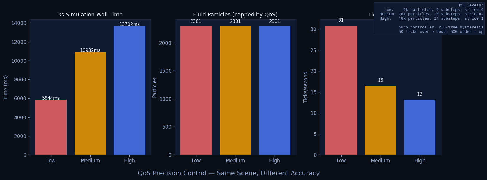

**What it shows:** The same water box at three `quality` levels. `Low 4/4k/stride4 → Medium 10/16k/2 → High 24/48k/1`. Auto controller downgrades after 60 over-budget frames, upgrades after 600 under-budget frames.

**Run:** `python demos/qos_precision.py` → `demos/output/qos_precision.png`

---

### 9 · WDL — one document, one world

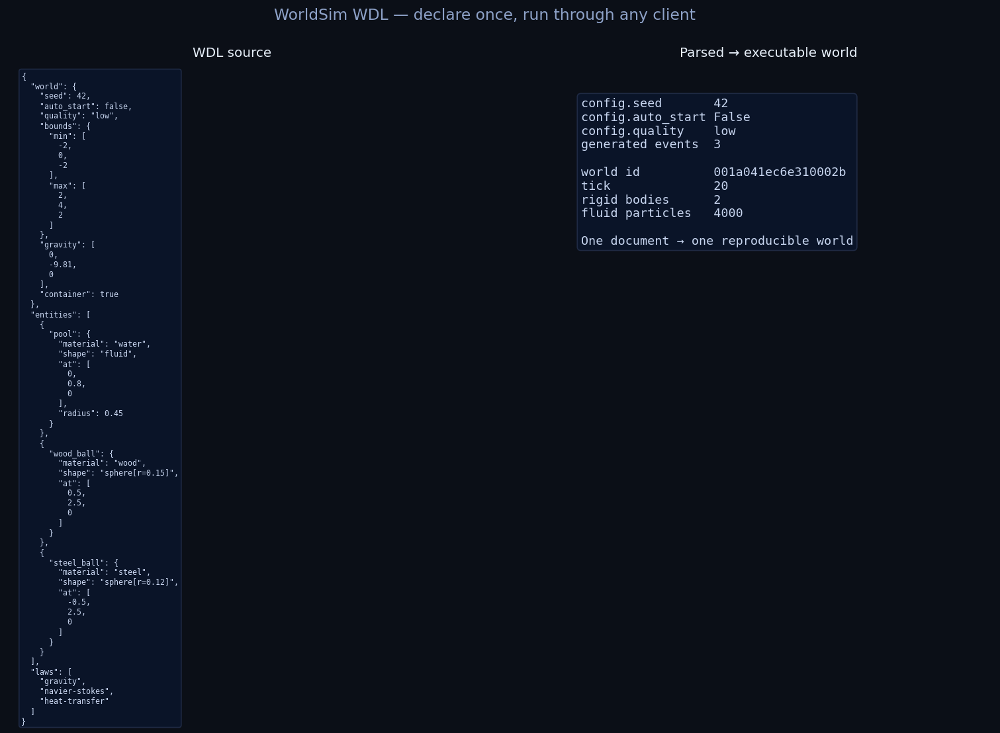

**What it shows:** World Description Language — a declarative JSON (+ `//` comments) with `world/entities/laws` expanded server-side into events. Validated via `POST /v1/wdl/parse`.

**Code:**
```python
wdl = json.dumps({"world":{"seed":42,"auto_start":False},
                  "entities":[{"ball":{"material":"wood","at":[0,2,0]}}]})
print(c.parse_wdl(wdl)["events"])
print(c.create_world_from_wdl(wdl)["id"])
```

**Run:** `python demos/wdl_scene.py` → `demos/output/wdl_scene.png`

---

### 10 · Full Scene — water + wood/steel/rubber + heat + probes

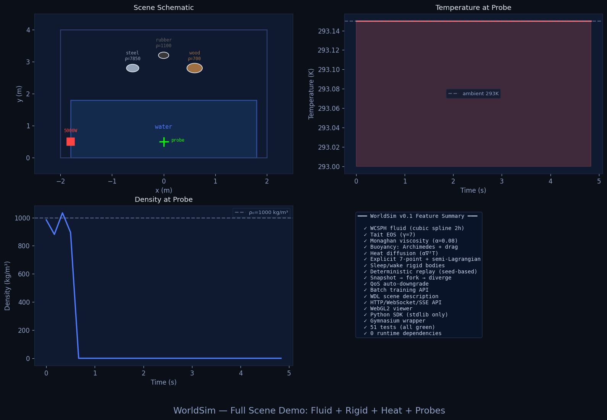

**What it shows:** All couplings at once plus a probe `temperature/density` time-series and a feature-summary panel. Uses the corrected `include_fields` heat grid, not empty probes.

**Code:**
```python
c.inject(wid, [
  {"type":"spawn_fluid","center":[0,0.9,0],"radius":0.75},
  {"type":"spawn_sphere","material":"wood","pos":[0.6,2.8,0],"radius":0.15},
  {"type":"heat_source","pos":[-1.8,0.5,0],"radius":0.3,"power_watts":5000},
])
r = c.step_sync(wid, 1)
print(c.probe(wid, 0, 0.5, 0, quantity="temperature"))
```

**Run:** `python demos/full_demo.py` → `demos/output/full_demo.png`

---

### 11 · True 3D — x/y/z columns in a 3D axes

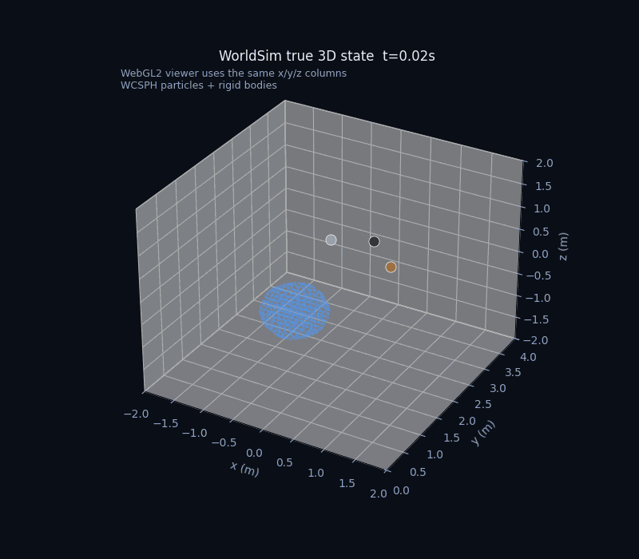

**What it shows:** The **same public state** that feeds WebGL2, plotted offline with Matplotlib `Axes3D.scatter(fx,fy,fz)` + `scatter(bx,by,bz)`. No hidden 2-D projection; the source is `observation.bodies/fluid px/py/pz`.

**Run:**
```bash
pip install -r demos/requirements.txt  # numpy, matplotlib, Pillow
python demos/three_d_scene.py           # → demos/output/three_d_scene.gif
# or all at once
python demos/run_all.py                 # 11 demos sequentially
python demos/run_all.py --demo 3 --port 8090
```

---

## Project Layout

```
worldsim/
├── crates/ws-core, ws-domain, ws-solvers, ws-engine, ws-server
├── worldsim/            # binary (worldsim demo / serve)
├── viewer/              # WebGL2 3D viewer (bodies+fluid+nbody, persistent buffers)
├── sdk/python/          # stdlib Client + [training] Gym/BatchTrainer + examples
├── demos/               # 11 visual demos + output/*.gif|png (see demos/README.md)
│   ├── run_all.py --port 8090 --demo N
│   ├── requirements.txt  (numpy/matplotlib/Pillow for GIFs)
│   └── three_d_scene.py  (offline 3D companion to the WebGL2 view)
├── docs/                # DESIGN, api, physics, configuration, training, viewer, roadmap
└── .github/workflows/ci.yml  # rust fmt/clippy/test + python compile/import
```

---

## Roadmap

`docs/roadmap.md` tracks the path from v0.1 to the full *physics OS* vision:

- **v0.2** — Per-region octree LOD with attention-driven allocation, region-level snapshots, material coarse-graining pipeline.
- **v0.3** — Distributed workers, world migration, `worldsim cluster` mode.
- **v1**   — Pluggable law registry (Force/Flux/Constraint/Event traits) + WDL scene language + WASM in-browser kernel.

See also the original design doc: [`docs/DESIGN.md`](docs/DESIGN.md).

---

## Contributing

See [CONTRIBUTING.md](CONTRIBUTING.md).  TL;DR:

```bash
cargo fmt --check && cargo clippy --workspace --all-targets -- -D warnings && cargo test --workspace
python -m compileall sdk/python/worldsim
node --check viewer/app.js
```

Every physics change needs an analytic validation test.

## License

MIT — see [LICENSE](LICENSE).
