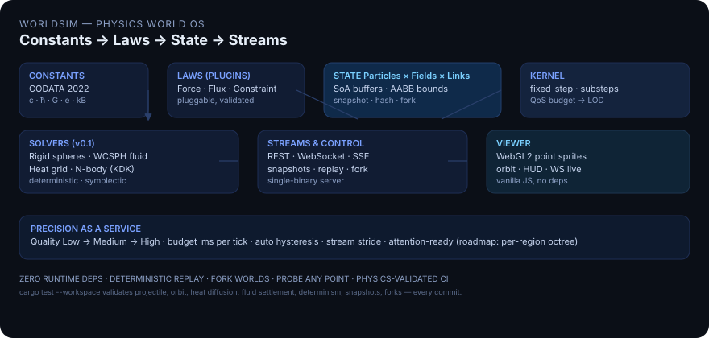

# WorldSim

> **Physics-world simulation infrastructure.**  
> A deterministic, multi-scale physics kernel that any project can consume as a service — with live WebGL2 visualization and a Python SDK.

[](https://github.com/hyqzz/worldsim/actions/workflows/ci.yml)
[](LICENSE)
[](CHANGELOG.md)
[](https://www.rust-lang.org)
[](#supply-chain)

**English** · [中文 README](README.zh-CN.md) · [Architecture](docs/DESIGN.md) · [API](docs/api.md) · [Changelog](CHANGELOG.md)

```
 ███╗   ███╗ ██████╗ ██████╗ ██╗     ██████╗ ███████╗██╗███╗   ███╗
 ████╗ ████║██╔═══██╗██╔══██╗██║     ██╔══██╗██╔════╝██║████╗ ████║
 ██╔████╔██║██║   ██║██████╔╝██║     ██║  ██║███████╗██║██╔████╔██║
 ██║╚██╔╝██║██║   ██║██╔══██╗██║     ██║  ██║╚════██║██║██║╚██╔╝██║
 ██║ ╚═╝ ██║╚██████╔╝██║  ██║███████╗██████╔╝███████║██║██║ ╚═╝ ██║
 ╚═╝     ╚═╝ ╚═════╝ ╚═╝  ╚═╝╚══════╝╚═════╝ ╚══════╝╚═╝╚═╝     ╚═╝
       Constants → Laws → Particles × Fields × Links → Streams
```



### Why WorldSim?

Most physics engines are *libraries you link*. WorldSim is **infrastructure you run** — like a database for physics:

- **Any project** (game, robotics/digital twin, research, teaching) talks to the same HTTP/WebSocket API.
- **Precision is a service** — `quality: low|medium|high` plus a `budget_ms` QoS controller downgrades gracefully under load and upgrades when spare.
- **Correctness is tested, not claimed** — every commit runs 7 analytic validation problems (projectile, Kepler orbit, heat diffusion, fluid settlement, determinism, snapshot, fork).

---

## 60-second quickstart

### 1 · Run the server

```bash
git clone https://github.com/hyqzz/worldsim && cd worldsim
cargo run -p worldsim -- demo --port 8090
# Viewer  http://127.0.0.1:8090/viewer/
# Health  http://127.0.0.1:8090/healthz
# API     http://127.0.0.1:8090/v1/worlds
```

Or download the prebuilt binary from [Releases](https://github.com/hyqzz/worldsim/releases).

### 2 · Open the viewer

Visit `http://127.0.0.1:8090/viewer/` — the demo world is already running: a water tank with a floating wood ball, a sinking steel ball, and a heat source.  Drag to orbit, scroll to zoom, click the ground to spawn.

### 3 · Talk to the API (curl)

```bash
# create a world
curl -s -X POST http://127.0.0.1:8090/v1/worlds \
  -H 'Content-Type: application/json' \
  -d '{"name":"hello","config":{"quality":"medium"}}' | jq
# → {"id":"...","world":{...}}

WID=<id from above>

# inject a water blob + two spheres
curl -s -X POST http://127.0.0.1:8090/v1/worlds/$WID/events \
  -H 'Content-Type: application/json' \
  -d '{"events":[
    {"type":"spawn_fluid","center":[0,1.0,0],"radius":0.7},
    {"type":"spawn_sphere","material":"wood","pos":[0.4,2.6,0],"radius":0.17},
    {"type":"spawn_sphere","material":"steel","pos":[-0.4,2.6,0],"radius":0.11}
  ]}' | jq

# probe anywhere in space
curl -s "http://127.0.0.1:8090/v1/worlds/$WID/probe?x=0&y=0.5&z=0&quantity=temperature" | jq
```

### 4 · Python SDK (stdlib only)

```bash
pip install -e sdk/python   # or: pip install worldsim  (when on PyPI)
python sdk/python/examples/quickstart.py
```

```python
from worldsim import Client
c = Client("http://127.0.0.1:8090")
w = c.create_world(name="hello", config={"quality": "medium"})
wid = w["id"]
c.inject(wid, [
    {"type": "spawn_fluid", "center": [0, 1.0, 0], "radius": 0.7},
    {"type": "spawn_sphere", "material": "wood", "pos": [0.4, 2.6, 0], "radius": 0.17},
])
print(c.probe(wid, 0, 0.5, 0, quantity="density"))
for frame in c.watch(wid, max_frames=1):
    print(frame["tick"], frame["bodies"]["n"], frame["fluid"]["n"])
```

---

## What it simulates (v0.1)

| Scale | Theory | Solver | Validation |
|---|---|---|---|
| Macroscopic rigid | Impulse + Coulomb friction, Baumgarte | Symplectic Euler, BVH grid | Projectile vs analytic < 0.8% |
| Mesoscopic fluid | WCSPH (cubic spline 2h, Tait γ=7, Monaghan α) | CFL-limited substeps | Tank settles, mass conserved |
| Continuum thermal | ∂T/∂t = α∇²T + advection + sources | Explicit 7-pt + semi-Lagrangian | 1-D cosine decay < 5% |
| Planetary | Softened Newtonian, direct sum | Leapfrog KDK | 2-body orbit, energy drift < 5e-4 |
| Coupling | Archimedes buoyancy + ½CdρAv² + 6πμrv | Sampled at bodies | Wood floats / steel sinks |

Correctness is enforced by `cargo test --workspace` — 40 tests including the 7-problem validation suite under `crates/ws-engine/tests/validation.rs`:

```
projectile_analytic_no_drag  ·  circular_orbit_energy_is_conserved
heat_1d_cosine_decay  ·  fluid_tank_settles_and_conserves_mass
determinism_double_run  ·  snapshot_roundtrip_is_exact_and_resumable
fork_produces_independent_diverging_worlds
```

---

## API surface (see [docs/api.md](docs/api.md))

```
Worlds     POST /v1/worlds  GET /v1/worlds  GET /v1/worlds/:id  DELETE …
Control    POST /v1/worlds/:id/control   {action:"pause"|"resume"|"step"|"set_rate"}
Precision  PUT  /v1/worlds/:id/precision {quality:"low"|"medium"|"high"|"auto", budget_ms}
Events     POST /v1/worlds/:id/events   {events:[{type:"spawn_sphere"|"spawn_fluid"|"heat_source"|"apply_force"|"set_gravity"|"remove_body"}]}
Probes     GET  /v1/worlds/:id/probe?x=&y=&z=&quantity=temperature|density|pressure|velocity
State      GET  /v1/worlds/:id/state
Streams    GET  /v1/worlds/:id/stream    →  WebSocket (preferred) or ?format=sse
Snapshots  POST /v1/worlds/:id/snapshots  GET …/snapshots/:sid  POST …/restore  POST …/fork
```

All responses are JSON over UTF-8.  Snapshots encode binary arrays as Base64 of little-endian IEEE-754.

---

## Configuration (see [docs/configuration.md](docs/configuration.md))

```json
{
  "seed": 42,
  "dt": 0.0166667,
  "bounds": {"min": [-2, 0, -2], "max": [2, 4, 2]},
  "container": true,
  "gravity": [0, -9.80665, 0],
  "quality": "medium",
  "systems": {
    "rigid":  {"restitution": 0.6, "friction": 0.35, "substeps": 2},
    "fluid":  {"enabled": true, "h": 0.06, "rho0": 1000, "c": 12, "visc_alpha": 0.08},
    "heat":   {"enabled": true, "res": [48,48,48], "alpha": 1.43e-7, "volumetric_capacity": 4.186e6},
    "nbody":  {"enabled": false, "softening": 0.01}
  }
}
```

### Precision as a service

`PUT /v1/worlds/:id/precision {"quality":"high","budget_ms":8}`

The scheduler measures wall-clock per tick (EMA).  If over budget for ~60 ticks it steps down one level; if comfortably under for ~600 ticks it steps up.  Locked quality (`"auto": false`) never moves.  Streaming stride and fluid substep caps follow the active level — see `crates/ws-engine/src/qos.rs`.

---

## Supply chain

```
ws-core      (constants, math, RNG, JSON, Base64, SHA-1)   0 deps
ws-domain    (config, materials, events)                   → ws-core
ws-solvers   (rigid, fluid, heat, nbody, spatial)          → ws-core
ws-engine    (world, QoS, snapshot, replay)                → core+domain+solvers
ws-server    (HTTP + WebSocket, API, viewer embed)         → engine
worldsim     (binary)                                      → server
```

No runtime dependencies outside `std`.  Every algorithm is auditable, builds are reproducible, and the server is a single static binary.

---

## Project layout

```
worldsim/
├── crates/ws-core, ws-domain, ws-solvers, ws-engine, ws-server
├── worldsim/            # binary (worldsim demo / serve)
├── viewer/              # WebGL2 viewer (embedded into the binary)
├── sdk/python/          # stdlib-only Python SDK + examples
├── docs/                # DESIGN, api, physics, configuration, roadmap
└── .github/workflows/ci.yml
```

---

## Roadmap

`docs/roadmap.md` tracks the path from v0.1 to the full *physics OS* vision:

- **v0.2** — Per-region octree LOD with attention-driven allocation, region-level snapshots, material coarse-graining pipeline.
- **v0.3** — Distributed workers, world migration, `worldsim cluster` mode.
- **v1**   — Pluggable law registry (Force/Flux/Constraint/Event traits) + WDL scene language + WASM in-browser kernel.

See also the original design doc: [`docs/DESIGN.md`](docs/DESIGN.md).

---

## Contributing

See [CONTRIBUTING.md](CONTRIBUTING.md).  TL;DR:

```bash
cargo fmt --check && cargo clippy --workspace --all-targets -- -D warnings && cargo test --workspace
python -m compileall sdk/python/worldsim
```

Every physics change needs an analytic validation test.

## License

MIT — see [LICENSE](LICENSE).
