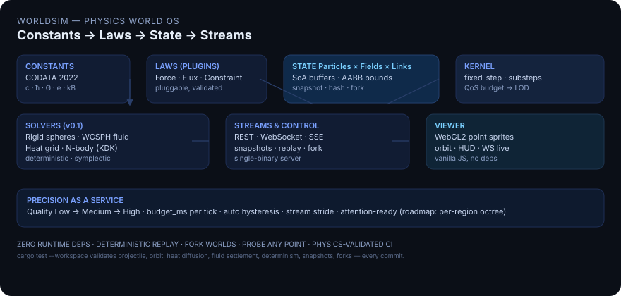

# WorldSim

> **物理世界仿真基础设施。**  
> 一个确定性的多尺度物理内核，任何项目都能像使用数据库一样通过服务来消费——附带实时 WebGL2 可视化与 Python SDK。

**[English README](README.md)** · [架构](docs/DESIGN.md) · [API](docs/api.md) · [更新日志](CHANGELOG.md)



### 为什么需要 WorldSim？

大多数物理引擎是**你链接的库**。WorldSim 是**你运行的基础设施**——1990 年的数据库 moment，如今发生在物理上：

- **任何项目**（游戏、机器人/数字孪生、科研、教学）都对同一套 HTTP/WebSocket API 说话。
- **精度即服务** —— `quality: low|medium|high` 加上 `budget_ms` 的 QoS 控制器在算力紧张时优雅降级、有空闲时自动升级。
- **正确性被测试而非被宣称** —— 每次提交都跑 7 个解析解验证问题（抛体、开普勒轨道、热扩散、流体静止、确定性、快照、分叉）。

### 60 秒快速开始

```bash
git clone https://github.com/hyqzz/worldsim && cd worldsim
cargo run -p worldsim -- demo --port 8090
# 浏览器打开 http://127.0.0.1:8090/viewer/
```

```bash
# 创建世界 → 注入水 + 两个球（木头浮、钢铁沉——浮力是真的）
curl -X POST http://127.0.0.1:8090/v1/worlds -H 'Content-Type: application/json' -d '{"name":"hello"}'
WID=<返回的 id>
curl -X POST http://127.0.0.1:8090/v1/worlds/$WID/events -H 'Content-Type: application/json' -d '{"events":[
  {"type":"spawn_fluid","center":[0,1.0,0],"radius":0.7},
  {"type":"spawn_sphere","material":"wood","pos":[0.4,2.6,0],"radius":0.17}
]}'
curl "http://127.0.0.1:8090/v1/worlds/$WID/probe?x=0&y=0.5&z=0&quantity=temperature"
```

```python
from worldsim import Client
c = Client("http://127.0.0.1:8090")
w = c.create_world(name="hello")
wid = w["id"]
c.inject(wid, [{"type":"spawn_fluid","center":[0,1.0,0],"radius":0.7}])
for frame in c.watch(wid, max_frames=1):
    print(frame["tick"], frame["bodies"]["n"], frame["fluid"]["n"])
```

完整 API 见 [docs/api.md](docs/api.md)，物理细节见 [docs/physics.md](docs/physics.md)，配置见 [docs/configuration.md](docs/configuration.md)。

### 验证

```bash
cargo test --workspace   # 40 项测试，含 7 个解析解验证
```

见 [CONTRIBUTING.md](CONTRIBUTING.md) 与 [SECURITY.md](SECURITY.md)。

### 许可

MIT — 见 [LICENSE](LICENSE)。
